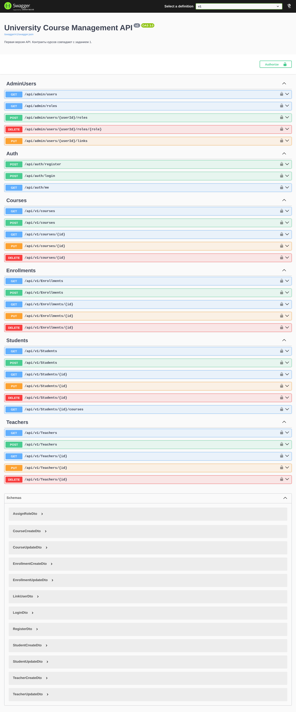
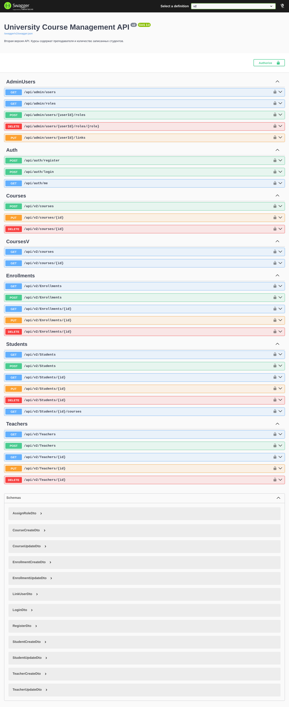
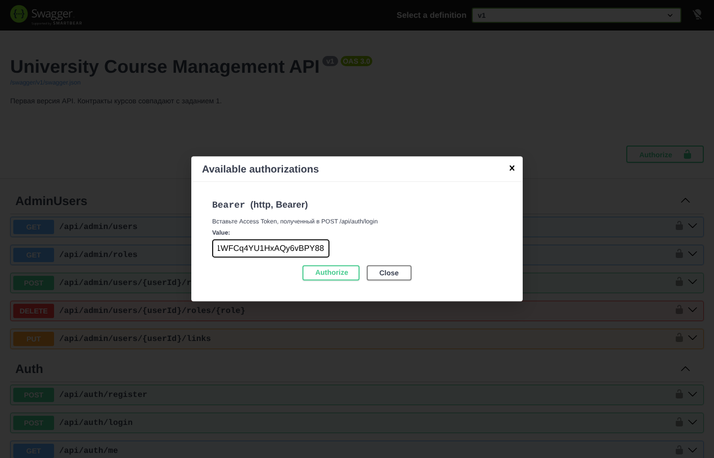

# Задание 2, модули 5-8. University Course Management API

Продолжение задания 1. В API добавлены JWT, ASP.NET Core Identity, роли Admin, Teacher и Student, проверка владения данными, CORS, версии API v1 и v2 и клиентское приложение WebClient.

Стек: .NET 10, ASP.NET Core Web API, EF Core + PostgreSQL, Identity, JWT Bearer, Asp.Versioning, Swagger, ASP.NET Core MVC.

## Запуск

1. Запустить PostgreSQL (строка подключения в `WebApi/appsettings.json`).
2. Задать ключ JWT, в репозитории его нет:

   ```bash
   dotnet user-secrets --project WebApi set "Jwt:Key" "случайная-строка-не-короче-32-символов"
   ```

3. Запустить API: `dotnet run --project WebApi --launch-profile https`, Swagger на https://localhost:7009/swagger. Миграции и тестовые данные применяются при старте.
4. Запустить клиент: `dotnet run --project WebClient --launch-profile https`, адрес https://localhost:7100.

Дамп базы с тестовыми данными: `WebApi/database/dump.sql`.

## Тестовые пользователи

Пароль у всех `Passw0rd!`.

| Логин | Роль | Привязка |
|---|---|---|
| admin | Admin | нет |
| teacher.petrov | Teacher | курс «Базы данных» |
| teacher.smirnova | Teacher | курс «Математический анализ» |
| student.ivanov | Student | Алексей Иванов |
| student.sokolova | Student | Мария Соколова |

## Что сделано

- **CORS:** политика `UniversityClients` пропускает только адреса клиента `https://localhost:7100` и `http://localhost:5100`.
- **Клиент WebClient:** MVC-приложение, получает курсы через `IHttpClientFactory`, адрес API берёт из `appsettings.json`, обрабатывает недоступность API и ошибки.
- **JWT:** `POST /api/auth/login` выдаёт токен на 15 минут с id, логином, ролями и привязкой к студенту или преподавателю. Проверяются подпись, Issuer, Audience и срок.
- **Identity:** регистрация (`POST /api/auth/register`, всегда роль Student), вход, `GET /api/auth/me`, уникальное имя, требования к паролю, блокировка после 5 неудачных попыток.
- **Роли:** Admin управляет всем и назначает роли через `/api/admin/...`. Teacher меняет оценки только на своих курсах. Student видит только свои оценки.
- **Версии:** `/api/v1/courses` возвращает прежний контракт, `/api/v2/courses` добавляет преподавателя и число студентов. Обе версии используют один сервис.

Аутентификация определяет, кто пользователь (проверка пароля и токена). Авторизация определяет, что ему можно (роль и владение объектом). Одной роли мало: Teacher с правильной ролью всё равно получает 403 на чужом курсе.

## Схема запроса

```
Client -> ExceptionMiddleware -> Routing -> CORS -> Authentication (JWT) -> Authorization (роли)
       -> Controller (проверка владения) -> Service -> Repository -> PostgreSQL
```

## Сценарии безопасности

| № | Сценарий | Результат |
|---|---|---|
| 1 | аноним получает курсы | 200 |
| 2 | аноним создаёт курс | 401 |
| 3 | неверный пароль | 401, токена нет |
| 4 | верный пароль | 200, JWT |
| 5 | просроченный JWT | 401 |
| 6 | Student удаляет курс | 403 (пользователь вошёл, но прав нет) |
| 7 | Teacher ставит оценку на своём курсе | 200 |
| 8 | Teacher ставит оценку на чужом курсе | 403 |
| 9 | Student смотрит чужие оценки | 403 |
| 10 | Admin назначает роль | 200 |
| 11 | Student назначает себе Admin | 403 |
| 12 | запросы к v1 и v2 | 200 и 200 |

## Скриншоты

Swagger, документ v1:



Swagger, документ v2:



Ввод JWT через Authorize:


